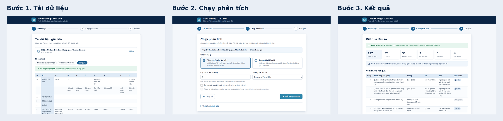

# Thiết kế giao diện: luồng 3 bước

Yêu cầu của người hướng dẫn: tool có 3 bước **1. Tải dữ liệu gốc lên → 2. Chạy phân tích → 3. Kết quả đầu ra**.
Tài liệu này là bản thiết kế mà code trong `server/static/index.html` làm theo. Ảnh thiết kế nằm ở `docs/design/`
(chụp từ chính giao diện đã code). Prompt để dựng lại thiết kế trong Figma AI nằm ở `docs/FIGMA_AI_PROMPT.md`.



Các ảnh trong `docs/design/`: `01_tai_du_lieu`, `01a_tai_du_lieu_rong`, `02_chay_phan_tich`, `02b_dang_chay`, `03_ket_qua`,
`04_trang_thai_loi`, `05_dien_thoai_1` đến `3`. Chụp lại bằng `python tools/capture_design.py --input <tệp .xlsx>`.

## 1. Nguyên tắc

- Mỗi màn hình chỉ có **một việc chính** và **một nút chính** (màu xanh đậm).
- Người dùng luôn biết đang ở bước nào (thanh bước), đã làm gì (tóm tắt tệp/sheet/cột), và làm gì tiếp theo.
- Không cần đọc hướng dẫn: giá trị mặc định đã đúng cho tệp bảng giá Thanh Oai (tự nhận diện sheet và cột).
- Lỗi nói bằng tiếng Việt dễ hiểu và cho cách làm tiếp, không hiện mã lỗi kỹ thuật.

## 2. Design system

**Màu** (cùng tông xanh nước biển với bản máy tính)

| Tên | Mã | Dùng cho |
|---|---|---|
| navy-900 | `#0B2545` | Thanh tiêu đề, tiêu đề chữ |
| navy-700 | `#13315C` | Chữ đậm thứ cấp |
| ocean-600 | `#1E6091` | Nút chính, liên kết, bước hiện tại |
| ocean-500 | `#2E86AB` | Nút chính khi rê chuột |
| ocean-100 / 50 | `#DEEAF6` / `#F0F6FC` | Nền nhấn nhẹ, tiêu đề bảng, cột được chọn |
| bg | `#F4F7FB` | Nền trang |
| surface | `#FFFFFF` | Thẻ (card) |
| border | `#D7E0EA` | Viền |
| text / muted | `#26384D` / `#5B6B80` | Chữ thường / chữ phụ (đều đạt tương phản AA) |
| success | `#146C43` trên `#E6F5EE` | Thành công |
| warning | `#8A5A00` trên `#FEF5E0` | Cảnh báo |
| danger | `#A32B1F` trên `#FDECEA` | Lỗi |

**Chữ**: Segoe UI (Windows) rồi Roboto, Helvetica Neue, Arial. Cỡ 12 (chú thích), 14 (phụ), 16 (thân), 20 (tiêu đề thẻ), 28 (tiêu đề trang). Giãn dòng 1,5.

**Khoảng cách** (thang 4): 4, 8, 12, 16, 24, 32, 48. Bo góc: 8 (ô nhập, nút), 14 (thẻ), 999 (nhãn tròn). Đổ bóng thẻ: `0 1px 2px` và `0 8px 24px` màu navy mờ.

**Thành phần**: Thanh bước (Stepper), Thẻ (Card), Vùng thả tệp (Dropzone), Chip tệp, Tab sheet, Bảng xem trước, Thẻ chọn chế độ (Option card), Ô nhập, Công tắc/hộp chọn, Nút (chính, phụ, chữ), Thanh tiến trình, Hộp nhật ký, Thẻ thống kê, Nhãn cách xử lý (Badge), Thông báo (thông tin, cảnh báo, lỗi, thành công).

## 3. Ba màn hình

### Bước 1: Tải dữ liệu gốc lên

```
┌ Tách Đường · Từ · Đến ─────────────────────────────────────────┐   thanh tiêu đề navy
        ① Tải dữ liệu ──── ② Chạy phân tích ──── ③ Kết quả            thanh bước
┌────────────────────────────────────────────────────────────────┐
│  Tải dữ liệu gốc lên                                           │
│  ┌ ─ ─ ─ ─ ─ ─ ─ ─ ─ ─ ─ ─ ─ ─ ─ ─ ─ ─ ─ ─ ─ ─ ─ ─ ─ ─ ─ ┐   │
│  │        ☁  Kéo thả tệp .xlsx vào đây hoặc bấm để chọn    │   │  Dropzone
│  └ ─ ─ ─ ─ ─ ─ ─ ─ ─ ─ ─ ─ ─ ─ ─ ─ ─ ─ ─ ─ ─ ─ ─ ─ ─ ─ ─ ┘   │
│  Sau khi tải: [BGĐ_Update....xlsx · 41 KB · 3 sheet] [Đổi tệp]  │  Chip tệp
│  Sheet: (Thanh Oai sau sáp nhập) (Giáp ranh + Ven trục) (Bảng giá)  Tab sheet
│  ✓ Đã nhận diện cột B «Tên đường phố»                          │  Thông báo
│  ┌ bảng xem trước 12 dòng đầu, cột B được tô xanh nhạt ───────┐ │
│                                              [ Tiếp tục → ]    │  Nút chính
└────────────────────────────────────────────────────────────────┘
```

Trạng thái: **rỗng** (viền nét đứt), **kéo thả** (viền đậm, nền xanh nhạt), **đang tải** (vòng xoay), **thành công** (chip tệp và bảng xem trước), **lỗi** (thông báo đỏ: sai định dạng, quá lớn, tệp hỏng).

### Bước 2: Chạy phân tích

```
│  Chạy phân tích                                                │
│  Tệp: BGĐ_Update....xlsx · Sheet: Bảng giá                      │  tóm tắt
│  Chế độ                                                        │
│  (●) Thêm 3 cột vào tệp gốc      ( ) Bảng đối chiếu giá        │  Option card
│  Cột chứa tên đường [ B ]    Thứ tự cột [ Đường → Từ → Đến ▾ ]  │
│  [ ] Ẩn cột gốc sau khi tách   [ ] Dùng AI (Gemini) cho câu khó │
│  [ ← Quay lại ]                        [ ▶ Bắt đầu phân tích ]  │
│  ── khi chạy ──                                                │
│  ▓▓▓▓▓▓▓▓░░░░ 62%   Đang tách dòng 79/127                       │  Thanh tiến trình
│  ┌ nhật ký ───────────────────────────────────────────────┐    │
```

Trạng thái: **sẵn sàng**, **đang chạy** (form khoá, có tiến trình và nhật ký), **lỗi** (thông báo đỏ, form mở lại, nút "Thử lại"). Ô AI bị làm mờ kèm lý do khi máy chủ chưa có API key.

### Bước 3: Kết quả đầu ra

```
│  ✓ Đã tách xong 127 dòng                                       │  Thông báo thành công
│  [127 dòng] [70 quy tắc] [51 kế thừa] [2 đối chiếu] [0 AI] [4 giữ nguyên]   Thẻ thống kê
│  ℹ Mở tệp Excel: ba cột tô xanh nhạt nằm ngay sau cột B.        │
│  ┌ xem trước 40 dòng đầu: Dòng | Gốc | Đường | Từ | Đến | Cách xử lý ┐
│  [ ⬇ Tải tệp Excel kết quả ]   [ Chạy lại với cài đặt khác ]  [ Tệp khác ]
```

Trạng thái: **thành công** (có cảnh báo vàng nếu phải ghi cột vào cuối bảng), **hết hạn** (tệp đã bị xoá sau 1 giờ, nút tải báo lỗi rõ ràng).

## 4. Responsive và khả năng truy cập

- Từ 880px trở lên: nội dung rộng tối đa 1040px, thẻ thống kê 6 cột. Dưới 880px: 3 cột; dưới 560px: 2 cột, thanh bước chỉ hiện số và tên bước hiện tại, bảng cuộn ngang trong khung.
- Mọi thao tác dùng được bằng bàn phím; vùng thả tệp là một nhãn gắn với ô chọn tệp; có vòng focus rõ.
- Thanh bước dùng `aria-current="step"`; tiến trình dùng `role="progressbar"`; thông báo trạng thái đọc được qua vùng `aria-live`.
- Chuyển bước thì đưa focus về tiêu đề của bước đó. Tôn trọng `prefers-reduced-motion`.
- Dữ liệu người dùng luôn được chèn bằng `textContent`, không bằng `innerHTML`, để tránh chèn mã độc.
